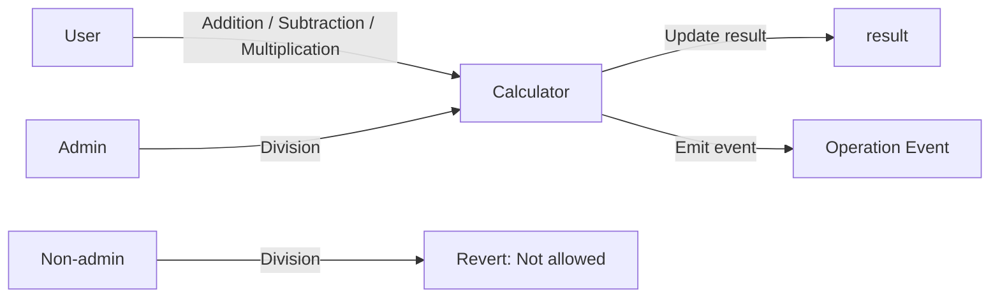

# <h1 align="center"> Calculator Smart Contract </h1>

Simple calculator smart contract built with Solidity and tested with Foundry.

The contract supports:

- Addition
- Subtraction
- Multiplication
- Division
- Admin-restricted division
- Unit testing
- Revert testing
- Fuzz testing
- Coverage analysis

---

## How it works

The project contains two main components:

1. [`Calculator.sol`](./src/Calculator.sol)  
   Contains the calculator logic, state variables, events and access control.

2. [`Calculator.t.sol`](./test/Calculator.t.sol)  
   Contains the Foundry test suite.

The contract stores the latest result in:

```solidity
uint256 public result;
```

It also stores an administrator address:

```solidity
address public admin;
```

Only the administrator can execute the `division()` function.

### System flow



---

## Technical docs

### Constructor

```solidity
constructor(uint256 initialResult_, address admin_) {
    result = initialResult_;
    admin = admin_;
}
```

Parameters:

- `initialResult_`: initial value stored in `result`.
- `admin_`: address authorized to call `division()`.

---

### Addition

```solidity
function addition(
    uint256 num1_,
    uint256 num2_
) external returns (uint256 result_);
```

Adds two `uint256` values, stores the result and emits `AdditionEvent`.

---

### Subtraction

```solidity
function subtraction(
    uint256 num1_,
    uint256 num2_
) external returns (uint256 result_);
```

Requires:

```solidity
num2_ <= num1_
```

Otherwise it reverts with:

```text
Result cannot be negative
```

---

### Multiplication

```solidity
function multiplication(
    uint256 num1_,
    uint256 num2_
) external returns (uint256 result_);
```

Solidity `0.8.24` automatically reverts on arithmetic overflow.

---

### Division

```solidity
function division(
    uint256 num1_,
    uint256 num2_
) external onlyAdmin returns (uint256 result_);
```

Only the configured admin can execute this function.

```solidity
modifier onlyAdmin {
    require(msg.sender == admin, "Not allowed");
    _;
}
```

If `num2_ == 0`, the function returns `0`.

```solidity
if (num2_ == 0) return 0;
```

Division uses integer arithmetic, so:

```text
5 / 2 = 2
```

---

## Events

```solidity
event AdditionEvent(uint256 num1, uint256 num2, uint256 result);

event SubtractionEvent(uint256 num1, uint256 num2, uint256 result);

event MultiplicationEvent(uint256 num1, uint256 num2, uint256 result);

event DivisionEvent(uint256 num1, uint256 num2, uint256 result);
```

---

## Testing

Tests are implemented with Foundry in:

```text
test/Calculator.t.sol
```

Run all tests:

```bash
forge test
```

Run with detailed output:

```bash
forge test -vvvv
```

Run a specific test:

```bash
forge test --match-test testDivision
```

---

## Foundry cheatcodes used

### `vm.prank`

Executes the next external call as a specific address.

```solidity
vm.prank(admin);
calculator.division(5, 2);
```

### `vm.startPrank` / `vm.stopPrank`

Executes multiple calls as the same address.

```solidity
vm.startPrank(admin);

calculator.division(10, 2);
calculator.division(20, 4);

vm.stopPrank();
```

### `vm.expectRevert`

Checks that the next call reverts.

```solidity
vm.expectRevert();
calculator.multiplication(num1_, num2_);
```

---

## Fuzz testing

The project includes fuzz testing.

Foundry automatically generates values for test parameters.

Example:

```solidity
function testFuzzingDivision(
    uint256 num1_,
    uint256 num2_
) public
```

The number of fuzz runs is configured in [`foundry.toml`](./foundry.toml):

```toml
[fuzz]
runs = 330
```

---

## Test coverage

Generate the coverage report with:

```bash
forge coverage
```

Foundry reports coverage for:

- Lines
- Statements
- Branches
- Functions

---

## Project structure

```text
calculator/
├── src/
│   └── Calculator.sol
├── test/
│   └── Calculator.t.sol
├── lib/
│   └── forge-std/
├── foundry.toml
└── README.md
```

---

## Foundry configuration

```toml
[profile.default]
src = "src"
out = "out"
libs = ["lib"]

[fuzz]
runs = 330
```

---

## Requirements

- Solidity `0.8.24`
- Foundry
- Forge
- `forge-std`

---

## Installation

Install Foundry:

```bash
curl -L https://foundry.paradigm.xyz | bash
foundryup
```

Install project dependencies:

```bash
forge install
```

---

## Build

```bash
forge build
```

---

## Run tests

```bash
forge test
```

---

## Coverage

```bash
forge coverage
```

---

## Security considerations

- `division()` can only be called by the configured admin.
- Arithmetic overflow and underflow are checked automatically by Solidity `0.8.24`.
- Subtraction prevents negative results.
- Division by zero returns `0` instead of reverting.

---

## License

MIT
